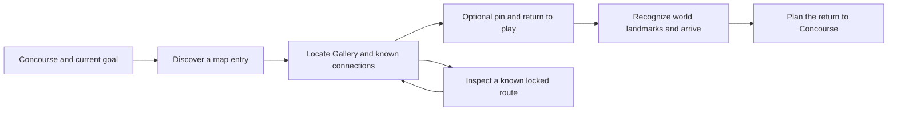

# Worked UI scenarios

**Date:** 2026-10-20. **Status:** Authored design examples and paper-prototype specifications. No UI was implemented or playtested. These examples illustrate contracts, not selected screen layouts or art treatments.

## A. Lantern Arcade: discover, navigate and return

The owner reported that players asked for a map and may not have learned how to find the existing one. That leaves several possible causes: unnoticed entry point, unclear controls, insufficient map information, or trouble relating map and world. This pass did not inspect a build and does not choose among those causes.

**Task:** reach Gallery from Concourse, return to Concourse, then explain one known locked route. Map opening is an intermediate behavior, not the final success condition.

### Proposed information and action contract

| Player question | Candidate representation | Important boundary |
| --- | --- | --- |
| Where am I? | Named current area, player position and facing where useful | Floor and map orientation must agree with the actual world |
| How can I plan a route? | Discoverable labelled Map entry plus current binding; pause/menu route as another entry | A working shortcut alone does not prove discovery |
| Which place is Gallery? | Same destination name on objective, map and relevant world signs | Names in this document are task fixtures, not verified current UI |
| How do I get there and back? | Readable known connections, landmarks and optional destination pin | Pinning must not imply a path exists or reveal undiscovered geometry |
| Why is this route unavailable? | Distinguish known locked, inaccessible, and not-yet-discovered states | Reveal only prerequisites allowed by the game's information policy |
| What happens when I close the map? | Return to the prior play/menu context with sensible focus | Specify whether the world continues, pauses or changes input mode |

The flow is proposed. Several physical UI designs could satisfy it. A destination list can complement a map when panning or zooming is difficult; it must not misrepresent route reachability. Guidance should remain adjustable if navigation challenge is part of play. [A04](SOURCES.md#a04-objective-clarity), [A05](SOURCES.md#a05-navigation-and-focus)

**Cold prompt:** “Reach Gallery from here, then return to Concourse.” Do not initially say “use the map.” Reaching the goal through world signs without opening the map is successful navigation; record map discovery separately. If stuck, record the unassisted result before offering increasingly specific help. Then test map operation directly as a separate diagnostic. A participant who succeeds after being told the shortcut has not demonstrated map discovery.

**Adversarial variants:** remap Map; open it from a submenu; interrupt a journey; re-enter after a gap; enlarge text; attempt the locked route; use a supported controller without a mouse. Record wrong turns, assistance, ignored or misleading signs, and whether the map and world tell the same story. This research authorizes no expansion of the tower or change to the previously chosen B art direction.

## B. Rainbreak Camp: make a capacity-sensitive forecast understandable

The Settlement Under Pressure fixture defines a four-day planning economy. The following reproduces its Case B day-2 plan at that reviewed commit. It is a demonstration, not a new economy or evidence that the fixture has sufficient strategic depth.

**Opening state:** day 2; three workers; Timber 5, Food 3, Cover 0; capacity 9 for each resource. Stove, Garden and Grove are ready; Loom is unbuilt. The known day-2 crisis demands 5 Food after normal upkeep of 3; day 4 will demand 4 Cover.

**Proposed assignments:** one worker builds Loom for 2 Timber; one operates Stove, spending 1 Timber and 1 Food to produce 6 Food; one operates Garden for 3 Food. Loom becomes ready on day 3. Costs are reserved from opening stocks, outputs arrive together, then the cap discards excess before upkeep and crisis payment.

### Candidate forecast content

| Food calculation | Amount after this step |
| --- | ---: |
| Opening Food | 3 |
| Reserve Stove input: −1 | 2 |
| Stove output +6 and Garden output +3 | 11 |
| Capacity 9: discard 2 | 9 |
| Upkeep: −3 | 6 |
| Day-2 crisis: −5 | **1** |

Timber ends at **2**: 5 − 2 construction − 1 Stove input. Cover remains **0**; construction does not operate the Loom today. End-of-day state is **(2 Timber, 1 Food, 0 Cover)**. Three assignments use all three workers.

A compact decision view could state: **“After this day: Food 1/9. Two Food discarded before upkeep. Loom ready day 3.”** Keep the crisis payment, remaining workers and next known Cover demand visible or immediately inspectable without mouse-only hover. A breakdown exposes the table above. This is a content proposal, not an approved copy/layout or alert severity.

### Required distinctions

- Current stocks versus reserved inputs versus projected closing stocks.
- A building under construction versus one available to operate now.
- A legal but dangerous plan versus an illegal assignment or unaffordable input.
- An exact result under this fully known fixture versus a conditional estimate in a different game.
- Reversible planning changes versus commitment to the day.

The UI should not mark a legal losing plan as an impossible input unless the game deliberately forbids it. Explain the consequence and apply the declared commitment policy. Conversely, allowing two actions to spend the same opening resource would violate the fixture, regardless of whether the interface looks clear.

**Prediction task:** before commitment, ask how much Food will remain and when Loom can work. Follow with a changed-state case to distinguish rule understanding from memorizing the displayed answer. Compare predictions with the authoritative resolver, including overflow, reservations and readiness. A paper calculation cannot verify an eventual implementation.

**Counterexample:** showing gross production “+9 Food” while hiding the cap and 8 Food of subsequent payments can create false confidence. A red counter at the end explains too little, too late. Showing a complete forecast still does not prove that the underlying choice is interesting; the settlement draft already records fixed-policy and forced-opening risks.

## Compare organization without changing the facts

For a later prototype, compare a simultaneous ledger/comparison view with a summary-and-inspector view. Give both the same rules, labels, forecasts and reachable reference information. Record comprehension, retrieval, errors, comparison burden and preference separately. Changing both the facts and the layout would make it hard to identify what helped.

Volans Nebula could later supply a conditional-estimate case: label the assumptions behind return fuel and explain what can invalidate them. Its current calculation and build were not inspected, so this packet supplies no numerical claim or implementation diagnosis for that game.

[Index](README.md) · [Evaluation protocol](2026-10-20-evaluation-and-adversarial-protocol.md)
